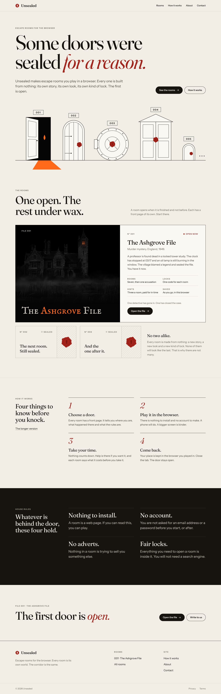
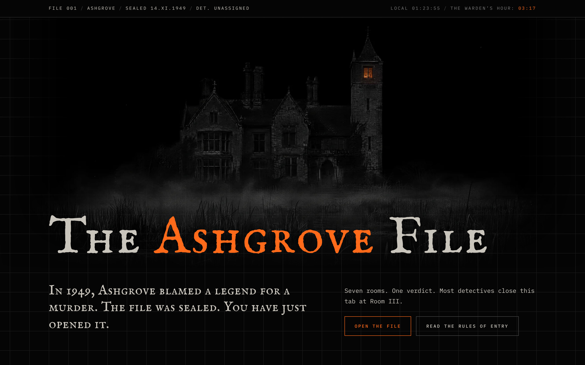

# Unsealed, and The Ashgrove File

Two things live in this repository.

**Unsealed** is the main website: the corridor that lists the escape rooms,
with the pages around it (how it works, about, contact, privacy, terms).

**The Ashgrove File** is the first escape room, File 001: a browser-based
murder mystery. Players enter a sealed 1949 case archive, solve one code per
room, and finally accuse the killer.



Each has its own layout, its own typefaces and its own stylesheet, and shares
none of them with the other. The main website is daylight: bone paper, black
ink, the red of sealing wax. A room is whatever that room is. A visitor picks
a room on the main website, lands on that room's own front page, and goes in
from there.



| Route | What it is |
| --- | --- |
| `/` | **The main website.** The corridor, the catalogue of rooms, how it works, the house rules. |
| `/how-it-works` | Start to finish, and the questions people ask. |
| `/about` | What a room is, how they are made, what every room keeps to. |
| `/contact` | A form. Messages go to an inbox no browser can read. |
| `/privacy`, `/terms` | The small print. Written from what the code does. |
| `/ashgrove` | **The Ashgrove File.** Its front page (the Threshold): hero, the legend, the victim, the rules of entry, the recruitment letter and the door. |
| `/ashgrove/oath` | Name, promise, badge. Optional Google link to keep the file on any device. |
| `/ashgrove/file/study` | Room I, The Study. |
| `/ashgrove/file/coroner` | Room II, The Coroner. |
| `/ashgrove/file/herbarium` | Room III, The Herbarium. |
| `/ashgrove/file/journal` | Room IV, The Journal. |
| `/ashgrove/file/register` | Room V, The Register. |
| `/ashgrove/file/marsh` | Room VI, The Marsh. |
| `/ashgrove/file/lamp` | Room VII, The Seventh Lamp. |
| `/ashgrove/verdict` | The accusation. Five photographs, the detective's own evidence, three chances to name the killer, then the closing account and a rank. |

The room used to live at the root, before there was a main website. Its old
addresses (`/oath`, `/file/{room}`, `/verdict`) redirect to the new ones. Any
other address gets one page, [`app/global-not-found.tsx`](app/global-not-found.tsx).

More screenshots are in [`docs/screenshots`](docs/screenshots).


Every room opens with the code of the room before it. A room's exhibit, the
statement of the person it points at, its papers, figures, question and hints
are read from Firestore, never from the bundle. Who did it is not in the
browser at all.

## The main website

Everything about it is in three places: [`app/(site)`](<app/(site)>) (the
pages and the stylesheet), [`components/site`](components/site) and
[`lib/site`](lib/site).

**The name.** It is written once, in [`lib/site/brand.ts`](lib/site/brand.ts).
Change `SITE.name` there and the header, the page titles, the footer, the
legal pages and the line at the foot of the room all follow. Then redraw the
picture that link previews show (below).

**The catalogue.** [`lib/site/catalogue.ts`](lib/site/catalogue.ts) lists the
rooms in order. An open room has a title, a few public facts, a picture and
the address of its own front page. A sealed room has a number and one line.
To add a room:

1. Build it under an address of its own, in its own route group with its own
   root layout, the way `app/(ashgrove)` is. It brings its own typefaces and
   stylesheet.
2. Add one entry to `CATALOGUE`. Nothing else on the main website changes.

Only what a room's own front page already says in public belongs in the
catalogue. Nothing from inside a room.

**The look.** Tokens are CSS variables in
[`app/(site)/site.css`](<app/(site)/site.css>). Like the room, it is flat: no
shadows, no blur, no gradients, and the hatching on a sealed plate is an SVG
tile. The one mask is on a room's photograph, the way the room shows it.

| Token | Value | Use |
| --- | --- | --- |
| `--bone` | `#F2EEE6` | The page |
| `--card` | `#FAF8F3` | Raised surfaces, fields |
| `--ink` | `#17140F` | Text, strong rules, the dark band |
| `--ink-2` | `#4A453C` | Secondary text |
| `--ink-3` | `#6B6458` | Labels and notes |
| `--rule`, `--rule-2` | `#D8D1C3`, `#B9B0A0` | Hairlines, field borders |
| `--wax`, `--wax-deep` | `#A4241B`, `#7C170F` | The one accent: seals, the mark, emphasis, focus |

Titles are Fraunces, everything else Instrument Sans. Both are downloaded at
build time and served from the site, so a visitor's browser never asks Google
for a font.

**What it loads.** Nothing of Firebase's. No page of the main website signs a
visitor in, sets a cookie or stores anything in the browser. The home page
asks Firestore's REST API one anonymous question, how many have entered and
closed The Ashgrove File ([`lib/site/stats.ts`](lib/site/stats.ts)). Firebase
is loaded only when someone presses Send on the contact form, and a visitor is
not given an account until they walk into a room. Links between the main
website and a room are plain `<a>` elements on purpose: the two have separate
layouts, so it is a full page load either way, and neither fetches anything of
the other ahead of time.

**Reading the contact form's messages.** They are in Firestore, in the
`messages` collection: Firebase console → Firestore Database → `messages`.
Each has `name`, `email`, `topic` (`broken`, `question`, `data` or `other`),
`message`, `createdAt`, `status` (`new` when it arrives) and, if the sender
has a file in a room, the `badge` and name on it. Nothing emails you when one
arrives. No browser can read or write that collection, whoever is signed in.

**The link preview picture** is `public/unsealed-og.png`. It is drawn from
the built site, so it always matches it:

```bash
npm run build
node scripts/make-og.mjs
```

It needs Playwright with a Chromium, which is not a dependency of this
project. Run it after changing the name, the headline, the colours or the
corridor drawing, and commit the picture.

**The small print.** `/privacy` and `/terms` are written from what the code
does: which service holds what, and where. If the code changes (a new field in
a player's file, analytics on or off, a new service), change the page in the
same commit and `LEGAL_UPDATED` in `lib/site/brand.ts` with it. They are plain
words, not a lawyer's, and they do not name a legal entity, a postal address
or a governing law.

## Stack

- **Next.js 16** (App Router) + TypeScript + **Tailwind CSS 4**, built as a
  static export (`output: 'export'`, `images: { unoptimized: true }`). No API
  routes, no middleware.
- **Firebase**: Hosting, Authentication, Cloud Firestore, Cloud Functions
  (2nd gen, TypeScript) and Analytics. Project id `ashgrove-file`.
- All server logic is five callable Cloud Functions: four for the room, one
  for the contact form. The browser never writes to Firestore.

## Requirements

| | |
| --- | --- |
| Node.js | **22** recommended (it matches the Functions runtime). 20.19+ also runs the site and the tests. |
| Java | **21 or newer**, for the Emulator Suite. |
| Firebase plan | **Blaze**, to deploy Cloud Functions. The emulators need no plan and no login. |

## Run it locally on the emulators

```bash
npm install
```

```bash
npm --prefix functions install
```

```bash
cp answers.example.json answers.json
```

Fill in `answers.json` (see [Seeding](#seeding-answers-and-room-content)). Then,
in one terminal:

```bash
npm run emulators:hosting
```

That compiles the functions, builds the site pointed at the emulators, and
starts Auth, Firestore, Functions and Hosting. When it prints
`All emulators ready`, seed the database from a second terminal:

```bash
npm run seed:emulator
```

| | |
| --- | --- |
| The site | http://127.0.0.1:5002 |
| Emulator UI | http://127.0.0.1:4000 |

Emulator data lives in memory. Seed again after every restart.

### With hot reload

`next dev` talks to the emulators by default (`.env.development`), never to
production.

```bash
npm run emulators
```

```bash
npm run seed:emulator
```

```bash
npm run dev
```

Then open http://localhost:3000. To point `next dev` at the live project
instead, create `.env.development.local` containing
`NEXT_PUBLIC_USE_FIREBASE_EMULATORS=false`.

## Seeding answers and room content

`scripts/seed.ts` uses the Admin SDK and writes these:

| Collection | Source | Contents |
| --- | --- | --- |
| `answers/{gate}` | `answers.json` | SHA-256 of the normalised answer and of any other accepted way of writing it, the three hint texts, the ids of the evidence the gate awards |
| `answers/verdict` | `answers.json` | SHA-256 of the id of the one who did it, and why it was not each of the others |
| `evidence/{id}` | `answers.json` | What a solved room gives up, the reason a wrong accusation missed, and the closing account |
| `rooms/{roomId}` | `scripts/content/rooms.ts` | Title, exhibit, witness, papers, figures, prompt |
| `rooms/verdict` | `scripts/content/rooms.ts` | The five who can be named, and what each of them said |
| `stats/global` | | `{ entered: 0, closed: 0 }`, created only if missing. Seeding never resets live counters. |

`answers.json` is **git-ignored**. It is the only place the codes exist in the
clear outside Firestore. Its shape is in `answers.example.json`:

```json
{
  "threshold": { "answer": "the word on the door" },
  "study": {
    "answer": "HH:MM",
    "hints": ["cheapest", "middle", "the answer itself"],
    "evidence": [
      { "id": "study-time-of-death", "title": "Time of death", "body": "One line.", "reveal": "HH:MM" }
    ]
  },
  "coroner": { "answer": ["one way of writing it", "another"], "hints": ["…", "…", "…"], "evidence": [] },
  "verdict": {
    "answer": "a-suspect-id",
    "rebuttals": { "another-suspect-id": "Why it was not them." },
    "evidence": [{ "id": "verdict-account", "title": "Their name", "body": "What happened." }]
  }
}
```

The seed validates everything before it writes: three hints per room, every
open room has an answer, every redaction points at evidence that exists, no
room document contains its own answer in plain text, the verdict names
someone who is on the wall, and every other suspect has a rebuttal.

### Sealed answers

A deploy needs `answers.json`, and the rooms in a commit can only be solved
with the answers written for that commit. So the answers travel with the
code, sealed:

```bash
npm run answers:seal
```

This writes `answers.sealed.json`, which **is** committed. It is
`answers.json` encrypted to the public half of the deploy's service account
key. Google publishes that half, so sealing needs no secret. Anyone can read
the sealed file. Only the holder of the private key can open it, and that is
the deploy workflow.

Seal again whenever `answers.json` changes, and whenever the deploy key is
replaced. A unit test fails if the sealed file is not the seal of the
`answers.json` beside it, and `npm run answers:check` says the same in one
line. The envelope is AES-256-GCM with the key wrapped by RSA-OAEP, made with
Node's own `crypto`: see
[`scripts/lib/sealed-answers.mjs`](scripts/lib/sealed-answers.mjs).

Keep your own copy of `answers.json` somewhere safe. The sealed file cannot
be opened without the deploy key, and you should not keep that key around.

**Emulator**

```bash
npm run seed:emulator
```

**Production**

```bash
npm run seed:prod
```

Production needs credentials with write access to Firestore. Either sign in
once with `gcloud auth application-default login`, or point
`GOOGLE_APPLICATION_CREDENTIALS` at a service account key (keep the key out of
the repository: `serviceAccount*.json` is git-ignored). The script asks you to
type the project id before it writes. `--dry-run` validates and writes nothing.

## Tests

```bash
npm test
```

| Command | What it proves |
| --- | --- |
| `npm run test:unit` | 84 tests. Answer normalisation and hashing. The room order in `firestore.rules` matches the code, and every room has content. Ranks. A pasted key is repaired or refused without any of it being shown. Sealed answers open only for the key they were sealed for. The project check, against a pretend Google. The main website's catalogue, its addresses and the redirects from the old ones, and the contact form's checks. Nothing from `answers.json` is in a tracked file. |
| `npm run test:rules` | 43 tests with `@firebase/rules-unit-testing`: a player cannot read a locked room, cannot read answers, cannot write their own progress. The wall stays shut until the seventh room is solved, who did it is never readable, and nobody can close their own case. Nobody can read or write the contact inbox. |
| `npm run test:functions` | 44 tests driving `checkAnswer`, `signOath`, `takeHint`, `accuse` and `sendMessage` through the emulators as a browser would: room order, ten tries a minute, unique badges, hint tiers and penalties, alternate spellings, three accusations, the rank, a case that is counted once, and a contact form that tidies what it is sent, refuses what is wrong and stops at three messages a day. |
| `npm run check:bundle` | After a build: no code, hint, evidence, rebuttal, statement, ledger row, line of cipher or room paper appears anywhere in `/out`. |
| `npm run verify` | Typecheck, lint, all tests, a production build and the bundle check. |

## Deploy

One-time setup in the Firebase console for `ashgrove-file`:

1. **Authentication → Sign-in method**: enable **Anonymous** and **Google**.
2. **Firestore**: note the database location, then set the matching region in
   [`functions/src/config/region.ts`](functions/src/config/region.ts). It is the
   only place the region is set. The web app reads the same constant. It is
   set to `northamerica-northeast1` (Montréal), where this project's database
   is.
3. **Billing**: the project must be on the **Blaze** plan.

You do not have to take these on trust. The
[Check deploy setup](https://github.com/Innovatiff/ashgrove-file/actions/workflows/check.yml)
workflow reads all three back from Google and says which is missing.

Then deploy either from GitHub or from a terminal. Both do the same four
things in the same order: rules, functions, seed, website.

### Deploy from GitHub

[`.github/workflows/deploy.yml`](.github/workflows/deploy.yml) deploys straight
from the repository. Nothing needs to be installed on your own machine. It
runs only when you start it, never on its own.

**1. Create a key the workflow can deploy with.** Open
[Google Cloud Shell](https://shell.cloud.google.com) (a terminal in the
browser, already signed in as you) and run these three commands.

```bash
gcloud iam service-accounts create github-deploy --project ashgrove-file --display-name "GitHub Actions deploy"
```

```bash
for ROLE in firebase.admin cloudfunctions.admin iam.serviceAccountUser artifactregistry.admin serviceusage.serviceUsageAdmin serviceusage.apiKeysViewer datastore.indexAdmin; do gcloud projects add-iam-policy-binding ashgrove-file --member "serviceAccount:github-deploy@ashgrove-file.iam.gserviceaccount.com" --role "roles/$ROLE" --condition None --quiet > /dev/null && echo "granted $ROLE"; done
```

```bash
gcloud iam service-accounts keys create key.json --iam-account github-deploy@ashgrove-file.iam.gserviceaccount.com && cat key.json
```

The last command prints the key. Copy all of it, from the first `{` to the
last `}`. The long line in the middle shows up broken across many rows. That
is fine, and so is a stray line above or below it: the workflow repairs both,
and proves the repaired key works before it uses it. Still take all of it. A
piece that went missing can only sometimes be worked out again. Once it is
saved in GitHub (next step), remove the copy:

```bash
rm key.json
```

| Role granted | What the deploy needs it for |
| --- | --- |
| Firebase Admin | Hosting, Firestore rules, seeding Firestore, reading the project config |
| Cloud Functions Admin | Creating and updating the functions, and making the callables reachable |
| Service Account User | Letting the functions run as the project's runtime account |
| Artifact Registry Administrator | Setting the clean-up policy for function build images |
| Service Usage Admin | Turning on the APIs the first functions deploy needs |
| API Keys Viewer | Reading the web app config during a Hosting deploy |
| Cloud Datastore Index Admin | Deploying `firestore.indexes.json` |

**2. Add the key as a secret.** On GitHub: **Settings → Secrets and
variables → Actions → New repository secret**
([direct link](https://github.com/Innovatiff/ashgrove-file/settings/secrets/actions/new)).

| Name | Value |
| --- | --- |
| `FIREBASE_SERVICE_ACCOUNT` | The key you just copied, whole |

Secrets are encrypted and cannot be read back, and nothing in the workflow
prints them. The key can deploy to your project, so treat it like a password.
To revoke it, delete it under **IAM → Service accounts → github-deploy → Keys**.

The answers need no secret. They are in the repository as
`answers.sealed.json`, sealed for this key, and the workflow opens them with
it (see [Sealed answers](#sealed-answers)). If you ever replace the key, run
`npm run answers:seal` again and commit the result. A secret named
`ANSWERS_JSON`, holding the contents of `answers.json`, is still read as a
fallback when there is no sealed file the key can open.

**3. Check the setup.** Open
[Check deploy setup](https://github.com/Innovatiff/ashgrove-file/actions/workflows/check.yml)
and click **Run workflow**. It deploys nothing and cannot change the project.
It takes about two minutes and lists what it found on the run's page:

| It checks | And tells you |
| --- | --- |
| The key | Whether it is there and readable. If not, what arrived instead, in counts only |
| The answers | Whether the sealed answers open with that key |
| Google | Whether it accepts the key, and whether the key is allowed to deploy |
| The project | Blaze plan, Firestore location against the functions region, Anonymous and Google sign-in |
| The rooms | Whether the answers fit the rooms (a dry run of the seed) |

A green tick means the deploy has what it needs. A red cross comes with the
line that says what to fix, and usually the link to fix it.

**4. Run it.** Open the workflow's own page:
[Deploy to Firebase](https://github.com/Innovatiff/ashgrove-file/actions/workflows/deploy.yml).
Click **Run workflow** and leave all four boxes ticked the first time.

If you go through the **Actions** tab instead, look in the left sidebar. The
middle of that page lists runs, and it stays empty until the first one. On a
phone or a narrow window the sidebar is tucked away, so use the link. The
**Run workflow** button only appears when you are signed in to GitHub as the
owner of the repository.

| Box | What it does |
| --- | --- |
| Firestore rules and indexes | `firebase deploy --only firestore:rules,firestore:indexes` |
| Cloud Functions | `firebase deploy --only functions` |
| Seed answers and room content | `npm run seed:prod`, from the `ANSWERS_JSON` secret |
| The website | `firebase deploy --only hosting` |

The deploy starts with the same checks. If a secret is missing or cannot be
read, or Google does not accept the key, the run stops in its first seconds
and says why, before anything is deployed. After changing a secret, start a
new run with **Run workflow**: **Re-run jobs** repeats the old run with the
old code. After the first deploy, a change that only touches the site needs
only the last box.

To deploy automatically on every push instead, add a `push` trigger to the
workflow. Give it a branch you only push finished work to.

### Deploy from a terminal

The same thing by hand, from a clone of the repository with `answers.json`
in place:

```bash
npx firebase login
```

```bash
npx firebase deploy --only firestore:rules,firestore:indexes
```

```bash
npx firebase deploy --only functions
```

```bash
npm run seed:prod
```

```bash
npx firebase deploy --only hosting
```

Either way, `deploy --only hosting` runs `npm run build` and
`npm run check:bundle` first (a predeploy hook in `firebase.json`), so it
always ships a fresh production build and refuses to ship one that leaks.

## How the game is protected

Client-side gating exists (`<Gate>`), but it is a courtesy. The locks are on
the server.

```
browser ──reads──▶ Firestore   (firestore.rules decides what is visible)
browser ──calls──▶ checkAnswer / signOath / takeHint / accuse   (the only writers)
```

A page can be reached a moment before the news that unlocks it: the door opens
when `checkAnswer` replies, and the copy of the file in the browser hears of
it separately. So `<Gate>` waits a second and a half before it turns anyone
away, and lets them in if the file catches up while it does.

**Data model**

| Path | Read by clients | Written by |
| --- | --- | --- |
| `players/{uid}` | Its owner only, one document at a time | Functions only |
| `rooms/{roomId}` | Only when the requester's `players` doc shows the room before it solved | Seed script |
| `rooms/verdict` | Only when the seventh room is solved | Seed script |
| `evidence/{id}` | Only when the id is already in the requester's `players.evidence` | Seed script |
| `answers/{gate}`, `answers/verdict` | Never | Seed script |
| `badges/{badge}` | Never | `signOath` |
| `stats/global` | Everyone | Functions only |
| `messages/{id}` | Never | `sendMessage` |
| `messageLimits/{key}` | Never | `sendMessage` |

`players/{uid}` holds `detectiveName`, `badge`, `oathAt`,
`solved { gate: timestamp }`, `evidence [ids]`, `hintPenalty` (minutes),
`hintsTaken { room: tier }`, `accusationsLeft`,
`attempts { gate: { count, windowStart } }`, and for the accusation
`accused [ids]`, `closedAt` and `rank`.

`messages` is the contact form's inbox, and `messageLimits` the counters that
keep it from being flooded. Neither belongs to the room.

Two of the room's collections go beyond the original four, both for a reason:

- **`evidence`**: the card a solved room awards contains the answer. Stored in
  `rooms/study` it would be readable before the room is solved, so it lives in
  its own collection that opens only once the function has added its id to the
  player's file. The reason a wrong accusation missed, and the closing
  account, are cards of the same kind: a detective can read only the ones
  they have earned.
- **`badges`**: a badge is unique because it is reserved as its own document
  inside the same transaction that assigns it.

**Functions** (`functions/src/handlers`)

| Callable | What it does |
| --- | --- |
| `checkAnswer({ room, answer })` | Normalises the answer (uppercase, spaces and punctuation stripped, times kept as `HH:MM`), compares its SHA-256 with `answers/{room}.hash`. Enforces room order and 10 tries per room per minute. On success writes the solved timestamp and evidence ids and returns the next route. Never returns an answer or a hash. |
| `signOath({ name })` | Requires the Threshold solved. Cleans the name, assigns a unique `ASH-XXXX` badge, writes the oath, increments `stats.entered`. Signing twice changes nothing. |
| `takeHint({ room, tier })` | Tiers in order only. Returns the hint text and adds 5, 10 or 20 minutes. Re-reading a hint already taken is free. |
| `accuse({ suspect })` | Requires all seven rooms solved. Hashes the name and compares it with `answers/verdict.hash`. A miss costs one of three accusations and is answered only with why it was not that person. The right name stamps `closedAt`, fixes the rank, hands over the closing account and adds one to `stats.closed`, once. Never returns the right name. |
| `sendMessage({ name, email, topic, message })` | The main website's contact form. Tidies and checks what it is sent, then writes one document to `messages/`. Three messages a day from one sender, two hundred a day from everyone, both counted in the same transaction as the write. A form field no person can see catches scripts: if it arrives filled in, the sender is thanked and nothing is stored. |

**Rank.** A closed case is ranked on what it cost: the minutes its hints
added, plus 30 for every accusation that missed. Nothing: Warden-Breaker. Up
to 15: Chief Inspector. Up to 60: Inspector. Up to 120: Sergeant. More:
Constable. The time on file is recorded beside the rank and does not change
it, so a detective who sleeps on a room is not marked down for sleeping.

## The room's design system

Tokens are CSS variables in [`app/(ashgrove)/ashgrove.css`](<app/(ashgrove)/ashgrove.css>), mirrored into
the Tailwind theme. The default Tailwind palette, shadows and blurs are
removed, so the nine tokens are the only colours a utility class can reach.

| Token | Value | Use |
| --- | --- | --- |
| `--void` | `#050505` | Page background |
| `--panel` | `#0D0D0D` | Panels |
| `--grid` | `#1A1A1A` | The 48px hairline grid |
| `--line` | `#2E2E2E` | Borders and rules |
| `--line-strong` | `#4A4A4A` | Line illustrations, active borders |
| `--muted` | `#7A7A7A` | Meta text |
| `--paper` | `#C9C5BD` | Body text |
| `--ember` | `#FF6A1A` | Key words, codes, CTAs, the lamp, progress |
| `--ember-dim` | `#7A3410` | Solved and disabled states |

Hard rules, kept by leaving things out: no glow, text-shadow, box-shadow,
blur, gradients, parallax, flicker, cursor effects or typewriter effects. The
only gradient functions in the project are the masks on scene images, and the
background grid is an SVG tile, not a gradient. The only motion is `<Reveal>`
and the one-time stroke drawing of illustrations, both off under
`prefers-reduced-motion`.

### Components

Everything a later room needs is exported from `@/components`.

| Component | What it is |
| --- | --- |
| `Frame` | The one-pixel frame with corner tick marks. `tone`, `active`, `label`, `mark`, `ticks`, `as`. |
| `DoubleRule` | A section title on two one-pixel lines, three pixels apart. `title`, `index`, `note`. |
| `Section` | A band held to the measure with registration crosshairs at its corners. |
| `FileLabel` | `FILE 001 / ASHGROVE / SEALED 14.XI.1949 / DET. {NAME}`. |
| `BlendImage` | `variant="cutout"`: transparent image straight on the page. `variant="scene"`: dissolves through a mask (`ellipse`, `fade`, `aspect`, `aspectNarrow`, `focus`). `annotation` adds a mono label on a leader line. |
| `PinnedPhoto` | Portraits only: framed, tilted, pinned, captioned. |
| `Reveal` | Opacity and 16px, 700ms, once, 80ms stagger for siblings. |
| `EvidenceCard` | A framed case document in Special Elite. `variant="evidence"` for what the detective has established. |
| `Redaction` | `Time of death: ████`, lifting to the value in orange. |
| `CodeInput` | Labelled mono input and submit. `format="time"` sets digits as `HH:MM`, `format="number"` keeps figures only. Reports wrong, blocked and error states. |
| `HintPanel` | Three tiers, one at a time, each behind a confirmation. |
| `LedgerFooter` | Rooms, time on file, accusations, and the live global counters. |
| `Paper` | One paper from a room: typed text, a ruled ledger, or a page of cipher. A ledger is a real table on a wide screen and a short list per row on a narrow one. |
| `WitnessCard` | A pinned photograph and what that person said. |
| `HallElevation`, `Lantern`, `Clock0317`, `Teacup`, `Candle`, `FoxgloveSheet`, `AlphabetStrip`, `Boardwalk`, `Dipstick` | Line illustrations. One part of each may be orange. |
| `Illustration` | The wrapper to build more: one-pixel strokes that draw once on entering view. |
| `Gate` | Client-side gating: `need="threshold" \| "oath" \| "verdict" \| roomId`. |
| `CaseRoom` | Lays out any room from its Firestore document. |
| `Verdict` | The accusation: the wall, the evidence, the name, and the closed case. |

## Changing a room

A room is two halves, kept apart on purpose.

1. **What a detective is shown** is in
   [`scripts/content/rooms.ts`](scripts/content/rooms.ts): the exhibit, the
   witness and their statement, the papers (text, ledgers, cipher), the
   figures and the question. Nothing in it may give the code away, and the
   seed refuses a room that contains its own answer.
2. **What a detective has to find** is in `answers.json`: the code (or a list
   of accepted ways of writing it), three hints, and the evidence card the
   room gives up.

Then seal and seed:

```bash
npm run answers:seal
```

```bash
npm run seed:emulator
```

Commit `answers.sealed.json` with the change. A room's page is two lines
(`<Gate need="…"><CaseRoom room="…" /></Gate>`), and a new line drawing is one
component in `components/illustrations` plus a line in its `FIGURES` registry.

Room ids and their order live in
[`functions/src/config/game.ts`](functions/src/config/game.ts). `firestore.rules`
carries its own copy (rules cannot import code) and a unit test fails if the
two disagree.

## Images

All fifteen were generated with Higgsfield. Every final prompt, the model, the
job ids and the reason each variation was kept are in
[`docs/image-prompts.md`](docs/image-prompts.md).

Full-size sources are not in the repository. To reprocess one, put its PNG at
`.image-src/{name}.png` and run:

```bash
npm run images -- --only {name}
```

## File tree

```
app/
  (site)/                    THE MAIN WEBSITE
    layout.tsx               its own root layout: typefaces, metadata, header, footer
    site.css                 its tokens and every primitive
    page.tsx                 home: the corridor, the catalogue, how it works
    how-it-works/  about/  contact/  privacy/  terms/
  (ashgrove)/                THE ASHGROVE FILE
    layout.tsx               its own root layout: typefaces, metadata, header,
                             ledger, providers
    ashgrove.css             its tokens and every primitive
    ashgrove/page.tsx        the Threshold, the room's front page
    ashgrove/oath/page.tsx   the Oath
    ashgrove/file/{room}/page.tsx   Rooms I to VII: study, coroner, herbarium,
                             journal, register, marsh, lamp
    ashgrove/verdict/page.tsx       the accusation
    ashgrove/icon.svg        the room's own tab icon
  global-not-found.tsx       the one 404 page, for any address on the site
  robots.ts  sitemap.ts
components/
  site/                      the main website: Masthead, Colophon, Corridor
                             (the drawing), Seal, RoomPlate, LiveCount,
                             PageHead, Clauses, ContactForm, Arrow
  index.ts                   everything the room exposes for later rooms
  ui/                        Frame, DoubleRule, Section, FileLabel, BlendImage,
                             PinnedPhoto, Reveal, EvidenceCard, Redaction,
                             CodeInput, HintPanel, LedgerFooter, SiteHeader,
                             LiveClock, TabTitle
  illustrations/             Illustration, HallElevation, Lantern, Clock0317,
                             Teacup, Candle, FoxgloveSheet, AlphabetStrip,
                             Boardwalk, Dipstick
  providers/                 AuthProvider (anonymous sign-in), ProgressProvider
  gate/                      Gate, Clearance
  threshold/                 HeroActions, Door
  oath/                      OathForm, KeepFile (Google link)
  room/                      CaseRoom, Paper, WitnessCard, useRoom, useVerdict,
                             useEvidence
  verdict/                   Verdict (the wall, the name, the closed case)
lib/
  site/                      the main website: brand (the name, the menu),
                             catalogue (the rooms), stats (the public count),
                             contact (the form's checks and its one call),
                             fonts, fonts-404
  firebase.ts                one initialisation; analytics after isSupported()
  api.ts                     the room's four callables, as the browser calls them
  progress.ts                players/{uid} read into what the interface needs
  rooms.ts                   room order and routes (ids only)
  clock.ts  format.ts  content.ts  public-images.generated.ts
functions/
  src/index.ts
  src/handlers/              checkAnswer, signOath, takeHint, accuse, sendMessage
  src/lib/                   answers (normalise + hash), player, validate, options
  src/config/                game.ts (room order, routes, limits, ranks),
                             contact.ts (the form's limits), region.ts
scripts/
  seed.ts                    answers, evidence, rooms, the accusation, stats
  seal-answers.mjs           seals answers.json for the deploy key
  ci-credentials.mjs         puts the key and the answers in place for a deploy
  ci-preflight.mjs           asks Google, read-only, whether the project is ready
  lib/                       secret-json (repairs a pasted key), sealed-answers,
                             google-preflight, ci-report
  check-bundle.ts            fails if anything secret is in /out
  process-images.mjs         sources to 2400px WebP
  make-og.mjs                draws the main website's link preview picture
  content/                   rooms.ts (the seven rooms and the wall), answers.ts
                             (reads answers.json), types.ts, images.generated.json
tests/
  unit/  rules/  functions/
docs/
  image-prompts.md
  screenshots/
public/images/               the room's fifteen .webp files
public/unsealed*.{svg,png}   the main website's icon and link preview picture
.github/workflows/
  deploy.yml                 deploy to Firebase from the Actions tab
  check.yml                  check the secrets and the project, deploy nothing
firebase.json  .firebaserc  firestore.rules  firestore.indexes.json
answers.example.json         the shape of the git-ignored answers.json
answers.sealed.json          answers.json, sealed for the deploy key
.env.local                   Firebase web config (public identifiers)
.env.development             next dev talks to the emulators
```

## Things worth knowing

- **Functions run on Node 22, not Node 20.** Google decommissioned the Node 20
  runtime for Cloud Functions on 30 October 2026, and `firebase-tools` refuses
  to deploy it. The runtime is set by `engines.node` in `functions/package.json`.
- **SDK versions are held one major back on purpose.** `firebase` 12,
  `firebase-admin` 13 and `@firebase/rules-unit-testing` 5 are the newest lines
  that still run on Node 20 and 22. Their successors require Node 24.
- **`.env.local` is tracked.** It holds only the Firebase web config, which is
  public by design and readable in the shipped bundle. Nothing secret belongs
  in it.
- **The repository is public, and so are the rooms' papers.**
  `scripts/content/rooms.ts` is everything a detective is shown, and anyone
  can read it here. What they cannot read here is what a detective has to
  find: the codes, the hints, the evidence, why it was not each suspect, and
  the closing account. Those are in `answers.sealed.json` only.
- **Functions run in `northamerica-northeast1`,** because that is where this
  project's Firestore database is. The region is one constant,
  `functions/src/config/region.ts`, and the web app reads the same one.
- **Each stylesheet reads only its own files.** `site.css` and `ashgrove.css`
  both start with `@import 'tailwindcss' source(none)` and then name the
  folders they belong to. A class used in a new folder produces no CSS until
  that folder is added to the right list.
- **The 404 page has its own copies of the typefaces,**
  `lib/site/fonts-404.ts`, with preloading off. It belongs to the whole site,
  so anything it preloads is preloaded by every page, the rooms included.
- **The room's first load is about 390 KB of JavaScript, gzipped,** roughly half of it the
  Firebase SDK. The pages are prerendered, so content paints without it.
  Loading Firebase after first paint is the obvious next optimisation.
- **Before a public launch**, turn on App Check for the functions and restrict
  the web API key to your domains. The per-player rate limit stops one
  detective guessing fast. It does not stop one person opening many files.
